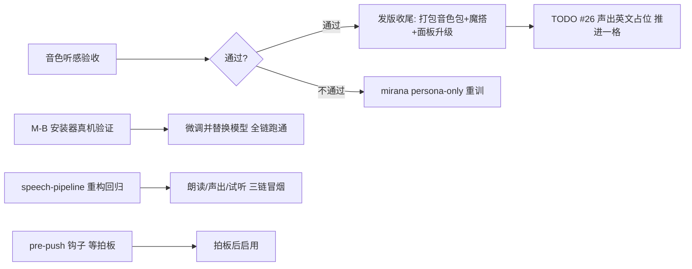

# 待验收清单 — 2026-11-02

来源：`docs/HANDOFF-2026-11-02.md`（语音管线会话）+ `docs/agents/handoff-asr-finetune-2026-11-02.md`（ASR 微调 T5 会话），外加拉取后新落的 `c217884`。
本文只收「等老板拍板/等真机跑一次」的项；已验证的现状照抄交接文档，不重述细节。

## 一、音色听感验收（最高优先，阻塞发版）

### 风行者 854 条版 — 已撤下（2026-11-08）

用户判定样本太少、稳定出错，不再发布：`refs.json` 条目已删（现 6 条），参考音频、训练素材（`D:\AI\windranger-finetune\`）、GV 包与 app 侧权重全部删除（约 2.2 GB）。本节清单不再需要执行，保留仅作历史。

- ~~试听 `D:\AI\windranger-finetune\test-new-voice.wav`~~
- ~~应用内试听（refs.json 已挂 `windranger-e15-854.ckpt` + `windranger_e8_s1384.pth`）~~
- ~~判定：听感是否可发布（854 = 436 至宝 + 461 本体 + 58 旧）~~
### 米拉娜 2218 条中英版

- [ ] 中文试听 `D:\AI\mirana-finetune\test-mira-v2.wav`
- [ ] 英文试听 `D:\AI\mirana-finetune\test-mira-v2-en.wav`
- [ ] 应用内试听（refs.json 已挂 `mirana-e15.ckpt` + `mirana_e8_s3520.pth`，盘上已核对）
- [ ] 判定：中英双语是否都自然；**特别听经典套（mira_，占 21%）有没有拖累**——wiki 记录经典套单独训过是失败的
- 若被拖累 → 走 persona-only 重训：过滤 `D:\AI\mirana-finetune\asr-out2\cleaned.list` 只留 `mira_per`，管线现成（`dota-voice-finetune` skill）

### 验收通过后的收尾（按序）

- [ ] 发版按 `dota-voice-release` skill：打包新音色包 → 上传魔搭仓 `a1078185271/oh-my-dota2-voicepacks` → 改 `voicepacks.json`（version + 精确字节数）→ 老用户面板点「升级」
- [ ] TODO #26「声出英文占位」推进一格（双语权重已就位）

## 二、音色包升级功能（代码已合，未发版）

- [ ] 面板升级流程走一遍：旧版本显示「有新版 v旧 → v新」+ 升级按钮 → 点击升级 → 安装状态正确（`feat/voicepack-upgrade` 已合 main `38d305f`，探针 54/0、typecheck/eslint 全绿，票 #22-#26 已关——这些是交接文档记录，未在本次复跑）
- [ ] 升级后音色试听正常、安装版本号记录正确

## 三、ASR 一键环境安装器（M-B，首次真跑）

- [ ] 训练管理窗口「一键安装训练环境」从零装一遍
  - 盘上 `data/asr-ft-env` **当前不存在**（已核对），即全新安装，无需先改名
  - 验证进度轮询（1.5s 轮询 `ft:asrft-status`）界面不卡、进度可信
  - 验证断点续传：中途断网/取消 → 重新按「安装」应接着下，不从头再来
- [ ] 装完用该环境跑一次「微调并替换模型」全链（开训 → 进度 → 导出 ONNX → 部署替换）
- [ ] 镜像 URL 未实测，失败即验收发现：看 `[asr-ft-install]` 前缀日志；三个待实测镜像
  - uv：`registry.npmmirror.com/-/binary/uv/`
  - torch cu121：`mirror.nju.edu.cn/pytorch-wheels/cu121/`
  - 底模：`hf-mirror.com`
- 已在役、不用重装：`data/asr-models/qwen3-asr/` 微调模型（真机 A/B 19/20 vs 底模 13/20）

## 四、speech-pipeline 重构回归（`c217884`，交接文档之后落的）

- [ ] 朗读链冒烟：队友消息进 → 分句 → 顺序播出，听感与重构前一致
- [ ] 声出链冒烟：`Alt+Shift+V` 说中文 → 识别 → 翻译 → 英文声出进游戏语音；`Alt+Shift+O` 面板「说一句试试」同链
- [ ] 面板试听（tts preview）正常
- [ ] 合成失败仍是「静音跳过、绝不退回系统嗓子」
- 自动门禁（commit 记录，未在本次复跑）：`--tts-pipeline-probe` 27/27、`--voice-out-probe` 60/60、`--tts-play-probe` ok

## 五、待拍板（非阻塞，等一句话）

- [ ] **pre-push 钩子**：`.githooks/pre-push` 跑 `npm run typecheck`，配 `git config core.hooksPath .githooks`。动机见 `docs/agents/retro-asr-finetune-2026-11.md`「高」节（d604fc1 漏提交推坏树）。启用与否等拍板。

## 六、不在本次范围（已有归属，别混进来）

- 训练管理窗口 T1–T6 验收 → issue #10–#16，清单在 `docs/ACCEPTANCE.md`
- 架构评审票 #27–#33 → 各自 issue，#27 已被 `c217884` 落地
- GSI 正文可靠性 #1（要一局真实天梯）、Edge 流式 #19、baker 声码器安装版 #21 等 → `docs/TODO.md` 待办节

## 环境提醒（勿重踩）

- 训练前停开发应用（`npm run dev:stop`）+ 确认 dota2 没开；GPU 协作先跟隔壁会话打招呼（intercom）
- 验收用的三个试听 wav 在 `D:\AI\` 下，属开发工作区素材，不入库
- 门禁复跑命令：`npm run typecheck`（双配置）、`npx eslint .`、build 后 `npx electron out/main/index.js --train-probe`
