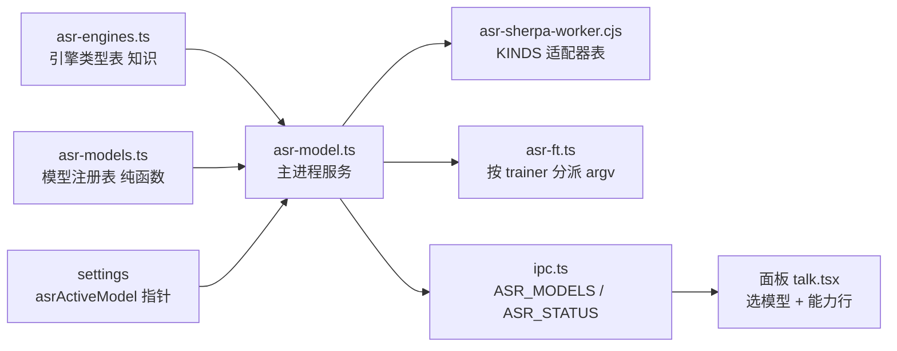
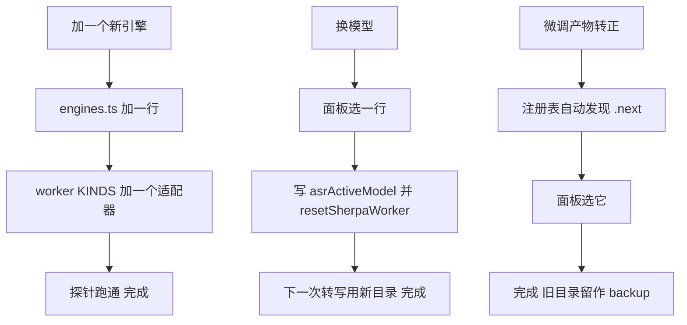

# ASR 引擎表：换模型不再是破坏性改动

## 症状

换一次识别模型（Qwen3 换微调权重、或者换成 paraformer），今天要动八处，漏一处就变成「点了没反应」或「识别直接加载失败」：

| 位置 | 写死了什么 |
| --- | --- |
| `resources/asr-sherpa-worker.cjs` 的 `loadRecognizer` | `modelConfig.qwen3Asr` 分支、六件套文件名 |
| `src/main/services/voice/qwen3-asr.ts` | 三条目录候选 `asr-models/qwen3-asr`、`sherpa-onnx-qwen3-asr-*`、`voice-runtime/models/qwen3-asr` |
| `src/shared/voice-runtime.ts` | `QWEN3_MODEL_FILES`、`QWEN3_MODEL_TOTAL_BYTES`、`hfMirrorFileUrl()` 固定仓库 |
| `src/main/services/voice/asr.ts` | 单腿，失败文案写死「Qwen3 模型未就绪」 |
| `src/shared/ipc.ts:187` + `src/main/services/settings.ts:96-98` | `asrEngine: 'whisper' \| 'qwen3'`，读入时钳成 qwen3（废字段） |
| `src/main/services/train/asr-ft.ts:56-73` | 训练脚本、导出脚本、base model、`qwen3-asr` / `.bak` / `.next` 三个目录 |
| `src/renderer/src/panel/pages/talk.tsx:184` | 静态文案 |
| `src/main/probes/settings-persist.ts` | 也要跟着改，否则探针红 |

同一个病在换模链路上已经发作过一次：换模守卫只认 `.next`，导致「应用新模型」按钮从未可用（wiki `obs-2026-11-07-next`）。现在要试 paraformer，病会再发一次。

实测数据支持这次改造的必要性（同 40 条 `data/asr-ft`，CPU 2 线程）：

| 模型 | CER | 带标点 | P50 |
| --- | --- | --- | --- |
| Qwen3 底模 | 6.27% | 40/40 | 677ms |
| Qwen3 现役（G14 微调） | 0.63% | 40/40 | 701ms |
| paraformer-large | 13.7% | 0/40 | 67ms |
| paraformer-small | 16.3% | 0/40 | 31ms |

差距不在「哪个模型更强」，而在「换一个要不要动八处、能不能微调」。所以先把换模这件事做成非破坏性，再谈选型。

## 目标与非目标

目标

- 加一个新引擎 = 表里加一行 + 一个 worker 适配器，其他文件不改（`docs/STANDARDS.md` 的「枚举 × 固定字段 → 写表」）。
- 换模型（同引擎不同权重、微调产物、备份） = 面板选一行，不动代码。
- 微调能力由表声明：能微调的引擎给出训练入口，不能的（FireRedASR、Dolphin 上游无训练脚本）显示不可用，而不是按钮点下去才报错。
- 漏一个引擎必须是编译错误或探针红，不是运行时静默。

非目标

- 不改识别算法本身；paraformer 只是第一个要验的第二行。
- 不做标点外挂（`OfflinePunctuation`）：paraformer 无标点在表里声明 `punctuation: 'external'`，实现留到后面。
- 不改热词机制：仍是 Qwen3 文本提示；不支持的引擎写 `hotwords: 'none'`。

## 设计：四层



### 第一层 引擎类型表（知识）

`src/shared/asr/engines.ts`，一行一个引擎。它回答「这种引擎长什么样」，不回答「磁盘上有没有」。

```ts
export type AsrEngineId = 'qwen3' | 'paraformer'
/** worker 适配器键，与 sherpa OfflineRecognizer.modelConfig 的字段名同名，少一层映射 */
export type AsrSherpaKind = 'qwen3Asr' | 'paraformer'

export interface AsrEngineSpec {
  id: AsrEngineId
  label: string
  sherpaKind: AsrSherpaKind
  /** 模型目录候选（userData 相对路径，按优先级；`*` 为前缀匹配） */
  dirCandidates: readonly string[]
  /** 判 ready 的必备文件（相对模型目录） */
  requiredPaths: readonly string[]
  /** 下载清单；null = 只能手动放置或微调产出 */
  download: { repo: string; files: readonly { name: string; bytes: number; sha256: string }[] } | null
  hotwords: 'prompt' | 'none'
  punctuation: 'builtin' | 'external' | 'none'
  /** 输出是空格分隔单字时要拼接（FunASR 家族） */
  joinChars: boolean
  finetune: AsrFinetuneSpec | null
  /** 一句话代价说明，面板直接显示 */
  note: string
}

export interface AsrFinetuneSpec {
  trainer: 'qwen3-sft' | 'funasr-paraformer'
  trainScripts: readonly string[]
  exportScripts: readonly string[]
  baseModelDirs: readonly string[]
  /** 转正必需产物（相对模型目录） */
  artifactFiles: readonly string[]
  dataset: 'qwen3-jsonl' | 'funasr-jsonl'
  /** 训练数据目录（userData 相对路径） */
  datasetDir: string
  /** 训练环境额外需要、缺失要显示出来的 python 包 */
  pythonExtra: readonly string[]
}
```

`ASR_ENGINES: Record<AsrEngineId, AsrEngineSpec>` 是唯一真相源。今天两行：

| 引擎 | requiredPaths | hotwords | punctuation | finetune |
| --- | --- | --- | --- | --- |
| qwen3 | `conv_frontend.onnx`、`encoder.int8.onnx`、`decoder.int8.onnx`、`tokenizer/vocab.json`、`tokenizer/merges.txt`、`tokenizer/tokenizer_config.json` | prompt | builtin | qwen3-sft |
| paraformer | `model.int8.onnx`、`tokens.txt` | none | external | funasr-paraformer |

### 第二层 模型注册表（事实）

`src/shared/asr/models.ts`，纯函数：把「磁盘扫到的目录事实」变成「可选的模型列表」。主进程只负责 `readdir` + `stat`，判断全在这里，所以能单测。

```ts
export interface AsrDirFact { rel: string; files: readonly string[]; bytes: number }
export interface AsrModel {
  /** 稳定 id：`<engineId>:<rel>`，settings 里存的就是它 */
  id: string
  engineId: AsrEngineId
  label: string
  rel: string
  ready: boolean
  bytes: number
  /** download=按表下载的；manual=手动解包；finetuned=训练/导出产物；backup=回滚点 */
  origin: 'download' | 'manual' | 'finetuned' | 'backup'
}
export function collectAsrModels(dirs: readonly AsrDirFact[]): AsrModel[]
export function pickActiveAsrModel(models: readonly AsrModel[], activeId: string): AsrModel | null
```

归属判定：目录名先按 `dirCandidates` 前缀匹配到引擎，匹配不上就忽略（`sense-voice` 这类退役目录自然消失，不用专门删）。`ready` = `requiredPaths` 全在。`origin` 由目录名后缀决定：`.bak` → backup，`.next` → finetuned，否则看是否等于 `dirCandidates[0]`。

`pickActiveAsrModel` 的回落规则写在这里，不写在 ipc 里：`activeId` 命中就返回它；没命中就返回第一条 `ready` 的；一条都没有返回 null。

### 第三层 指针

`settings.json` 新增 `asrActiveModel: string`（例如 `qwen3:asr-models/qwen3-asr`），默认 `''`。

迁移规则：`asrEngine` 保留为只读兼容字段（`settings.ts` 现有钳制逻辑不动，保证老配置读出来不崩），启动时若 `asrActiveModel` 为空则写入当前 Qwen3 现役目录的 id。行为跟今天一致。

### 第四层 worker 适配器

`resources/asr-sherpa-worker.cjs` 把 `loadRecognizer` 的分支拆成一张表，请求多带一个 `kind`：

```js
const KINDS = {
  qwen3Asr: (req) => ({
    tokens: '',
    qwen3Asr: { convFrontend: join(req.dir, 'conv_frontend.onnx'), encoder: ..., decoder: ...,
      tokenizer: join(req.dir, 'tokenizer'), hotwords: req.hotwords ?? '',
      maxTotalLen: 512, maxNewTokens: 512, temperature: 1e-6, topP: 0.8, seed: 42 }
  }),
  paraformer: (req) => ({
    tokens: join(req.dir, 'tokens.txt'),
    paraformer: { model: join(req.dir, 'model.int8.onnx') }
  })
}
```

识别器缓存键变成 `${kind}|${dir}|${hotwords}`（今天的键少了 `kind`，两种引擎同目录名会串）。文件末尾用 `if (require.main !== module) module.exports = { KINDS }` 暴露出去，探针才能比对键集合。

## 主进程改造

| 文件 | 动作 |
| --- | --- |
| `src/main/services/voice/qwen3-asr.ts` | 改名 `asr-model.ts`：`asrDirFacts()` 扫目录，`asrStatus()`、`ensureAsrModel(id)`、`transcribeAsr({ modelId, wav, hotwords })`，下载走 `spec.download.files`（bytes + sha256 逻辑复用） |
| `src/main/services/voice/asr.ts` | `transcribeWav(wav)` → 取 active 模型 → 取 `spec` → `sherpaTranscribe({ kind, dir, wav, hotwords })`，按 `spec.joinChars` 拼接；失败文案用 `spec.label` |
| `src/main/services/voice/sherpa-asr.ts` | `SherpaAsrRequest` 加 `kind: AsrSherpaKind`，转发到 worker |
| `src/shared/ipc.ts` | 新增 `ASR_MODELS: 'asr:models'`、`ASR_ACTIVE_SET: 'asr:active'`；`ASR_STATUS` / `ASR_DOWNLOAD` 参数改 `{ modelId }`；`asrEngine` 放宽成 `string`（兼容读） |
| `src/main/services/train/asr-ft.ts` | `layoutCandidates`、`activeDir` / `backupDir` / `stagingDir`、`FT_MODEL_FILES` 全部从 `spec.finetune` 取；`planAsrFtTrainArgv` 按 `trainer` 分派（qwen3-sft 保持原样，funasr-paraformer 产出 `torchrun funasr/bin/train_ds.py ++...`） |
| `src/renderer/src/panel/pages/talk.tsx` | 一行文案换成模型下拉（列表来自 `ASR_MODELS`）+ 能力行（热词 / 标点 / 可微调） |

## 三个流程各几步



## 防漏：探针断言清单

新增 `src/main/probes/asr-engines.ts`（`--asr-engines-probe`），`docs/PROBES.md` 登记一行。断言：

- 表里 `id` 与 `Record` 的键一致；每个 spec 的 `dirCandidates`、`requiredPaths` 非空。
- `download !== null` 的每个文件都有 `bytes` 与 64 位 `sha256`。
- `Object.keys(require('resources/asr-sherpa-worker.cjs').KINDS)` 与表里 `sherpaKind` 集合完全相等（漏一个引擎就是红）。
- 每个 `finetune !== null` 的 spec：`artifactFiles`、`trainScripts`、`baseModelDirs` 非空，`dataset` 在枚举内。
- 注册表：同一 `rel` 只出一条；`id` 稳定（同输入同输出）；`pickActiveAsrModel` 在失配时回落第一条 ready，无 ready 时返回 null。
- 迁移：legacy `asrEngine: 'whisper'` 的配置读出来仍指向 Qwen3 现役，`settings-persist` 探针保持绿。

## 工作量与顺序（每步单独可验收）

- 第一步 纯新增：`shared/asr/engines.ts` + `shared/asr/models.ts` + 探针。`asr.ts` 不动，行为完全不变。验收：两个 tsconfig 的 `tsc --noEmit` 绿、新探针绿、`settings-persist` 探针绿。
- 第二步 主进程切表：`asr-model.ts`、`asr.ts`、`sherpa-asr.ts`、`ipc.ts`、worker `kind`、`asrActiveModel` 迁移。验收：Qwen3 识别正常、微调转正正常、下载正常（`docs/ACCEPTANCE.md` 对应条目），日志里出现 `ASR_SHERPA_OK` 且 `kind:qwen3Asr`。
- 第三步 面板：talk.tsx 换下拉 + 能力行；训练页 ASR 段的引擎信息从表取。
- 第四步 第二行：paraformer 表项 + worker 适配器 + 下载清单（走 `motrix_download` 或表内镜像）；`asr-ft.ts` 补 `funasr-paraformer` 的 argv 规划。验收：面板里能切到 paraformer 并识别出一条；`docs/BENCH.md` 追加一组同批对照数字。

预计 400–500 行改动，其中约一半是迁移与探针。

## 风险与取舍

- worker 键名与 sherpa API 字段同名（`qwen3Asr` / `paraformer`）：少一层映射，代价是 sherpa 升级改字段名时表也要跟改——探针会先红，不会静默。
- paraformer 微调依赖 `funasr`：`data/asr-ft-env/venv` 实测没有（`ModuleNotFoundError: No module named 'funasr'`），只有开发环境 `D:/AI/GPT-SoVITS-v2pro-20250604/runtime/python.exe` 有 1.0.27。装进训练环境约 200MB，由 `pythonExtra` 声明并在训练页显示缺失项，不静默失败。
- 标点暂不做：paraformer 输出无标点（对比 0/40），翻译链路读起来会变差，这一步先接受。
- 备份目录列成一等公民：回滚变成「选一行」，不用再手工 `mv`。
- 注册表每次面板刷新都扫盘：目录数是个位数、每个只 `stat` 顶层文件，代价可忽略；不缓存就不存在缓存失效的坑。

## 未决问题

- `asrEngine` 兼容字段保留多久？提案：保留读、写入只写 `asrActiveModel`，下一个版本删掉，删时同步 `settings-persist` 探针。
- 标点外挂（`OfflinePunctuation`）排不排进这一步？提案：不排，等 paraformer 真的被选成主引擎再做。
- paraformer 微调要不要进这次范围？提案：这次只做「结构 + 能识别」，微调的 argv 规划进第四步但先不跑训练。
- **两种训练形态（#63 已落地）**：面板「开训方式」两档，默认「从底模重训」，另一档「接着上次权重」。
  - **从底模重训**：今天的路径，一步没改（`funasr-paraformer` 走 `++model=<底模 hub id>`，qwen3 走 `--model_path <底模目录>`，轮数/lr/argv 逐字不变）。
  - **接着上次权重（增量）**：起点是**上一轮 run 目录里的 pytorch 权重**（`model.pt.avg1` > `model.pt.best` > `model.pt`；qwen3 是最后一次 `checkpoint-<步数>`）——不是现役 `asr-models/<engine>`，因为现役是导出后的 int8 onnx，torch 接不上。决定后先把权重抄进 `asr-models/<engine>.next`（`stageIncrementalSource`），argv 只认这份副本：funasr `++init_param=<副本>`、qwen3 `--resume_from <副本>`，lr 1e-5，目标 ≈300 步（clamp 2–12 轮）。训练只写自己的 run 目录，失败也碰不到现役权重。
  - **拒启动而非 fallback**：没有上一轮 / 账本对不上（重录过、删过）/ 权重文件被删，三种情况都拒启动并把原因写进面板，绝不悄悄改跑一小时的重训。
  - **验证集是标尺**：增量沿用上一轮那份 eval 划分（`splitIncrementalEval`），新录的句子只进 train——否则 loss 没法跟前一轮横着比。
- **自定义录制（2026-11-09 记，用户提出）**：现在数据只能来自面板里那几组固定稿子（`asr-ft/Gxx/Gxx-Lnn.wav` + `resources/asr-ft-script.md` 的句子），用户想用自己的素材。三种来源都要接：
  - **自带 wav + 文本**：导入时校验 16k 单声道 PCM（`readWav16k` 那条口径），不符合的重采样或拒收并点名；文本缺了就不能进训练集（只能当识别测试）。
  - **自由说无稿**：`mode: 'free'` 组已经存在（G21 一类），但账本里它是「有什么说什么」；要给这类录一条「事后补文本」的口子，否则永远训不了。
  - **在线录制即训**：录完一句话就地加入待训清单（`asr-ft-datasets/train.jsonl` 增量 append），与「增量微调」那条直接连起来——录一句、训一个小步、立刻能听效果。
  - 落点仍是 `userData` 内的 `asr-ft/`、`asr-ft-datasets/`，不许多出外部路径依赖（AGENTS 硬规则）。

## 落地记录（2026-11-08）

第一步到第四步的识别侧全部落地，`npx electron out/main/index.js --asr-engines-probe` 40/40 PASS：

- 表：`src/shared/asr/engines.ts` 两行（`qwen3`、`paraformer`），类型 `AsrEngineId` / `AsrSherpaKind` 跟着长。
- 事实层：`src/shared/asr/models.ts`（目录模式 → 模型列表、来源分类、现役回落）。
- 副作用：`src/main/services/voice/asr-model.ts`（扫描、钉选、按表下载 + sha256、删除、转写）；`qwen3-asr.ts` 已删除。
- 适配器：`resources/asr-sherpa-worker.cjs` 的 `ASR_KINDS` 两个键，探针双向比对「表 ↔ worker」。
- 契约：`ASR_MODELS` / `ASR_ACTIVE_SET`（`asr:models` / `asr:active-set`），`settings.asrActiveModel` 持久化并在 `settings-persist` 探针里测过。
- 面板：`src/renderer/src/panel/pages/talk.tsx` 的「识别引擎」变成注册表下拉，能力行（热词 / 标点 / 可微调）全部从表里读。
- 训练腿：`src/main/services/train/asr-ft.ts` 的布局、现役 / 备份 / 待转正目录全部改从 `spec.finetune` 与 `spec.canonicalRel` 推导；`FT_MODEL_FILES` 来自 `artifactFiles`。
- 实测：同一段真人录音走 worker，paraformer 出「我没到还在冷却」（无标点），微调后的 qwen3 出「我没大，还在冷却。」——引擎路由与适配器都对。

## 落地记录：paraformer 的微调腿（2026-11-08 晚）

`AsrFinetuneSpec.trainer` 现在有第二个值 `funasr-paraformer`，训练目标由「现役模型属于哪个引擎」决定（`finetuneEngine()` 先看 `activeAsrModel()`，回落到表里第一个能训的引擎），所以选 paraformer 当现役就等于选它的训练腿。

- 表：`AsrFinetuneSpec` 拆成两半——`artifacts`（导出产物 `from → to` 改名表，paraformer 是 `model.int8.onnx → model.int8.onnx` 与 `tokens.txt → tokens.txt`）与 `borrow`（导出目录里没有时从备份 / 原始模型目录借的件）；另加 `baseModelIds`（FunASR 从 ModelScope 自己拉底模，不需要本地目录）、`exportTool`（打包的导出工具名）、`pips`（装环境要的冻结版本）与 `pythonExtra`（体检要 import 的模块名）。
- 数据：`dataset` 从 `qwen3-jsonl` 切成 `funasr-jsonl`，新格式只有五个字段 `key / source / source_len / target / target_len`，长度按 FunASR 的口径（`source_len` = 采样数/160 = 10ms 帧数，`target_len` = 字符数）。
- 训练 argv：`python -m funasr.bin.train ++model=<hub id> …`，与官方 finetune.sh 的差别只有三处——`batch_size=1`、`num_workers=0`、不跑 deepspeed。
- 导出不再直接调 `funasr.bin.export`，改走打包的 `resources/asr-ft-export-funasr.py`（导出 + 量化 + 补 sherpa 元数据一步做完）。原因有三条实测证据：FunASR 的导出只写 `model.onnx`/`model_quant.onnx`，而 sherpa 的 `OfflineParaformerModel` 还要 `tokens.txt` 和图上 metadata（缺 `vocab_size` 直接报 `'vocab_size' does not exist in the metadata` 拒绝加载）；`++model=` 必须是底模 id 或底模目录，喂 run 目录会让 AutoModel 把训练配置当模型配置读，导出半初始化的图（同一段音频：955 个 initializer 的导出解出「我没到还在冷却」，625 个的解出「藜藜崐 ad 或玖贩纷鄮纷狈赐缴拧」）；量化那步要 onnx ≥ 1.16，老的 onnx 1.14 会抛 `AttributeError: INT4`。
- 三条训练侧硬约束（都写进了 argv 注释与 `docs/NOTES.md`）：`validate_interval` 必须等于 `save_checkpoint_interval`（否则要么 `KeyError: model.pt.ep{epoch}.{step}`，要么收尾挑中「有记录没文件」的名字报 `No checkpoints found for averaging`）；`keep_nbest_models` 至少 2；`init_param` 必须是权重文件而不是目录。
- 进程：两条腿的 cwd 都钉在本次 run / 导出目录——hydra 会往 cwd 里建 `outputs/`，不钉就把垃圾写进安装目录（实测在仓库根拉出过 `outputs/2026-11-08/`）。
- 环境：`asr-ft-install.ts` 的 pip 清单 = 冻结清单 + 各引擎 `pips` 的并集（paraformer 追加 `funasr==1.0.27`），装一次两条腿都能训；面板体检会 import 一遍 `pythonExtra`，缺包直接在「开训体检」里点名。
- 实测证据（2026-11-08）：`.tmp/funasr-run4` 用 38 条真人录音跑完，产出 `model.pt / model.pt.best / model.pt.avg1`；`resources/asr-ft-export-funasr.py` 用同一份 checkpoint 导出后，worker 以 `kind=paraformer` 加载并解出「我没到还在冷却」「中路河道差个甲野」（G14-L01 / G15-L18），整链 `训练 → 导出 → int8+metadata → sherpa 推理` 打通；`ASR_ENGINES_PROBE 47/47 PASS`、`TRAIN_PROBE 91/91 PASS`、两套 tsc 干净、eslint 0 error。

### 真跑一遍之后又补的四件事（2026-11-08 深夜）

- 依赖：funasr 运行时 `import torchaudio` 却没在 setup 里声明，缺了 paraformer 训练腿一开就炸 → 冻结清单加 `torchaudio==2.4.1+cu121`，paraformer 的 `pythonExtra` 补 `torchaudio`。
- 底模来源：funasr 的 hub 下载**只走 modelscope**（`funasr/download/download_from_hub.py`），只装 `huggingface-hub` 时 `AutoModel` 拿到 `model_class=None`，报 `TypeError: 'NoneType' object is not callable` → paraformer 的 `pips` 加 `modelscope`，`pythonExtra` 也补上。
- 缓存位置：modelscope 默认把底模落进 `~/.cache/modelscope`，跑出应用数据目录 → `TrainPlan` 新增 `env`，funasr 的训练腿与导出腿都带 `MODELSCOPE_CACHE=<envRoot>/modelscope-cache`（`manager.spawnChild` 合并进子进程环境）。
- 导出权重：trainer 收尾会把「验证最好的那份」平均成 `model.pt.avg1`，而 `model.pt` 是最后一个 epoch → 导出按 `model.pt.avg1 → model.pt.best → model.pt` 挑，`planAsrFtExportArgv` 多一个 `weightsFile` 参数。

### G14 训一遍的实测结论（交叉验证：G14 训练 / G15 报数）

| 模型 | G14 CER | G15 CER |
| --- | --- | --- |
| paraformer 底模 | 17.79% | 10.39% |
| paraformer G14 微调（30 epoch） | 11.66% | 6.49% |
| qwen3 底模 | — | 0.65% |
| qwen3 G14 微调 | — | 1.30% |

微调方向正确（G14 的「真脸」修成「真眼」），但训练集自身只降到 11.66% = 欠拟合，20 条素材的信息量是瓶颈；paraformer 侧最好 6.49%，与 qwen3 的 0.65% 仍差一个数量级。数字入 `docs/BENCH.md`，G15 参与过 checkpoint 选择因而非盲测。

仍未做：paraformer 的标点外挂（`OfflinePunctuation`）；再录一批新句子做真盲测；把 30 轮往上加看 G14 能不能收敛。
