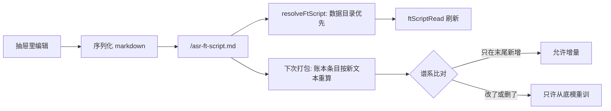

# 读稿编辑器（面板里改录制稿）

状态：已落地（2026-11-09）

## 症状

要换句子只能把 `asr-ft-script.md` 丢进数据目录再重启。用户的原话是「需要有自定义录制功能，不能放文件」。改一句话要开编辑器、找目录、重启应用，三件事都和「录个音」无关。

## 目标

在面板「识别训练 → 数据」卡里编辑读稿：新建组、改组标题、增删改句子，保存后立即生效（不必重启）。内置的 G01–G21 不再特殊——第一次编辑就把随包那份整份复制进数据目录，之后只改数据目录那一份（`resolveFtScript` 现有规则不变：数据目录优先、坏了回落随包并告警）。

不做的：不做「边录边改稿」的实时联动；不做句子排序拖拽；不做多份读稿切换（一份就是一份，换稿＝换数据集）。

## 界面

「数据」卡「读稿」行右侧加一个「编辑读稿」按钮，点开右侧抽屉：

```
┌ 编辑读稿 ──────────────────────────┐
│ [保存并生效]  [取消]   未保存 3 处   │
│                                     │
│ ▸ G01 日常        12 句  已录 12/12 │
│ ▾ G14 术语        20 句  已录 8/20  │
│    1  谁买活了？                      │
│    2  我先守肉山，你们推上路高地      │
│    3  [新句子输入框…]           ＋   │
│    ⚠ 第 4 句已录过录音，删掉后那条 wav 会变孤儿 │
│ ▸ G15 自由说        —   自由说组     │
└─────────────────────────────────────┘
```

- 每个组一行摘要（句数、已录数）；展开后句子逐行可编辑，末尾一行空输入框回车追加。
- 「＋ 新建组」在列表底部，新组 id 取下一个没被占用的 `Gxx`。
- 自由说组（没有编号句的组）只允许改标题与说明，不允许加句子——它的 wav 不按行号命名。
- 保存：写 `<userData>/asr-ft-script.md`（markdown 序列化，格式与随包读稿一致），随后刷新 `ftScriptRead` 与 `ftRecList`。

## 编号与删除

- 句子编号就是行序，`Gxx-Lnn` 由它推。**新增一律追加到组末尾**，不重排已有编号。
- 允许删除已录的句子，但删除前明确告警（该 wav 变孤儿，账本里仍留着，不影响训练，只是不再被引用）。
- 修改某句文本 = 同一个 `Gxx-Lnn` 换了内容，该行标记「需重录」，面板把这一行染成琥珀色并计入「待重录」。
- 「重录」= 人对着麦克风把新句子再念一遍，**只产生 wav，跟用哪个 ASR 模型无关**（识别模型不参与录音）。模型只在下一步「训练起点」出场：改了/删了就只能从底模重训，只在末尾新增才允许从现役微调模型增量。

## 谱系规则（这次最重要的一条）

用户口径：「新增、修改、删除都应该是基于原始模型重新录制的，只有在新增才支持增量，使用现有微调过的模型」。

落成一条可判定的规则：**能增量 ⇔ 上次训练打包过的每条录音（key + 文本）今天仍在，且文本一字未变**。

- 判据不需要新字段：每次 run 已经把打包快照存进 `runs.packed_ledger`（#59），拿它与当前账本逐条比即可：
  - 全部命中且文本相同、只是多了新条目 → 允许增量。
  - 有任何一条文本变了或被删了 → 不允许增量，面板把「从现役增量」置灰，并说明原因：`读稿改过（第 3、7 句文本变了，删了 2 句），只能从底模重训`。
- 「从底模重训」永远可选，不受谱系影响。它说的是**训练起点**取原始底模（`data/voice-runtime/models/qwen3-asr` 或 FunASR 的 hub 原始权重），跟「重录」是两件事：wav 还是你自己的声音，只是模型从零开始学这批音频。
- 录制侧的提示：改稿不会清掉旧 wav；被改的行在录制卡里显示「需重录」，录完覆盖同名文件，账本 revision 自然 +1。

## 数据流



## 拆分

- 纯缝（`src/shared/train/recording.ts`）：`serializeFtScript(groups)`、`appendScriptLine(groups, groupId, text)`、`updateScriptLine`、`deleteScriptLine`、`nextGroupId(groups)`、`assessScriptLineage(prevEntries, currentEntries)`（返回 `{ incremental: boolean, changed: string[], removed: string[] }`）。
- 主进程：`ftScriptSave`（写文件 + 备份上一份为 `asr-ft-script.bak.md`）、`ftScriptRead` 复用；`resolveAsrFtTrainRequest` 的增量分支先过 `assessScriptLineage`，不通过就返回带原因的拒绝。
- 契约：`IPC.FT_SCRIPT_SAVE` + `WindowApi.ftScriptSave`。
- 面板：抽屉组件 `script-editor.tsx` + 读稿行按钮 + 录制卡的「需重录」标记。
- 预览桩：给编辑器一组可点的假数据。

## 探针

- `--train-probe` 新增：序列化→解析往返一致（含自由说组与说明段）；追加不重排旧编号；删除句子后编号不变；`nextGroupId` 跳过已占用；谱系判据四种情形（纯新增=可增量、改文本=不可、删句子=不可、无变化=可增量）。
- 手测（写进 `docs/ACCEPTANCE.md`）：改一句 → 保存 → 录制卡出现「需重录」→ 增量置灰并给出原因 → 录完那句 → 增量恢复可选。

## 未决

- 保存时是否顺手在抽屉里提示「本次改动会让 N 条旧录音变成孤儿」——倾向提示但不拦。
- 是否需要「恢复随包读稿」按钮（删数据目录那份即可复原）——倾向要，一行按钮加一句确认。

## 落地记录（2026-11-09）

两条未决按「倾向」执行：保存时在抽屉底部显示孤儿数但不拦；「恢复随包读稿」做成按钮（`ftScriptReset`）。

- 纯缝在 `src/shared/train/recording.ts`，最终名字：`scriptPreamble`、`serializeFtScript`、`nextGroupId`、`addScriptGroup`、`renameScriptGroup`、`appendScriptLine`、`updateScriptLine`、`deleteScriptLine`、`deleteScriptGroup`（每个返回 `FtScriptEdit = { ok: true; groups } | { ok: false; error }`）。删到一句不剩的组回落成自由说，不留空壳逐句组。
- 谱系判据落在 `src/shared/train/asr-ft.ts` 的 `ftLedgerLineage(past, current)`：键在但 `text`/`bytes`/`mtimeMs` 变了记 `changed`，键没了记 `removed`，两者皆空才 `incremental`；`past` 为空一律 false。`findIncrementalSource` 用它逐轮比对，拒绝时说清「改了哪几句、删了几条」（`describeLineage`）。
- `scriptStaleKeys` 只比文本，经 `AsrFtStatusResult.scriptStale` 送到面板，把改过的句子标「需重录」——wav 还在，只是和新稿对不上，重录才会换成新文本。
- 主进程：`saveFtScript`（读当前生效稿取说明段、`serializeFtScript` 落盘、上一版写 `asr-ft-script.bak.md`）、`resetFtScript`（删数据目录那份回到随包稿）；契约 `IPC.FT_SCRIPT_SAVE` / `FT_SCRIPT_RESET`。
- 面板：`src/renderer/src/panel/components/script-editor.tsx` 复用现成的 `Modal`（没有另写抽屉原语）；入口在「数据」卡「读稿」行的「编辑」按钮，旁边是「恢复随包」。
- 探针（`--train-probe`，204/204 PASS）：序列化往返、加句取组内最大编号 +1、删行不复用编号、删空回落自由说、`nextGroupId` 跳过占用、改组标题不动句子、改文本点名 `scriptStaleKeys`、`ftLedgerLineage` 四情形。
