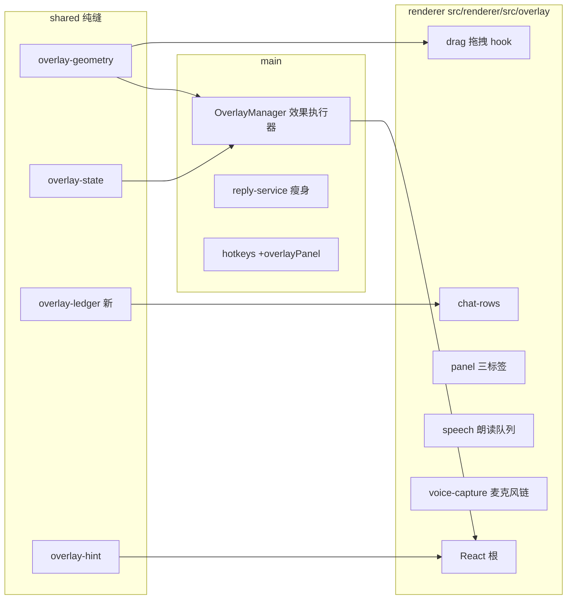

# 浮层 v2 设计（DESIGN-overlay-v2）

- 状态：已签收（2026-11-07，grill 访谈共识 + 本文档逐条落实）
- 关联：`docs/adr/overlay-reply-and-send-channels-removed.md`；GLOSSARY「浮层」「呼出面板」「原地直发」；`docs/DESIGN-panel-v2.md`（面板视觉语言的来源）

## 背景与目标

浮层 v1（`overlay.html` 316 行手写 CSS + `overlay.ts` 667 行 vanilla TS）功能齐但观感粗糙：amber 外框块面、状态条常驻、行内混排反馈杂乱。本次重做只对准浮层窗口（含它的 IPC 面），翻译/捕获/语音管线按现有契约复用——它们有探针钉着，不动。

目标一句话：**游戏画面上的干净字幕，不是仪表盘**。三件事：

- 视觉推倒重做：无外框卡片，行自成小胶囊，排版分层（原文弱、译文主）。
- 渲染层并入面板 v2 体系：React + Tailwind + `primitives` 同源的 HSL token。
- 交互收敛：删除回复框与两条旧文出通道（见 ADR），新增呼出面板承担「回看 / 要说话」类需求。

## 范围

### 删除（聊天链路，见 ADR）

- 浮层回复框：textarea、草稿落盘、已发送绿行、`sendReply`。
- `chat-send` / `console-send` 两个桥；设置 `sendMode` / `consoleKey`；面板「发送通道」行。
- `--input-probe`（案例并入 `--inplace-guard-probe`）。

### 保留（行为不变，代码重写搬进新架构）

- 双语消息行：原文 / 译文 / 英雄头像 / 词库「词」标 / 失败 ✕ / 翻译中占位 / 渐隐（12s） / 上限 40 行。
- 只译文 / 双语 / 只原文三种模式；行底色不透明度（0.05–0.9，默认 0.34）。
- 锁定 = 穿透 + 防截屏；解锁可拖 / 两侧拉宽 / 方向键微调（Shift=10px）/ 贴边吸附；5 秒闲置自动回锁。
- 收起小图标（132×34）；朗读（announce，队列上限 6，失败跳过不换嗓子）；语音对讲一键到底 + 行内反馈。
- 热键键名全部随状态下发（提示行教的是当前键，不是写死的键）。

### 新增

- 呼出面板（默认热键 Alt+Shift+H，可改）：浮层临时变交互面板，三个标签页——历史（200 条双语，点行复制译文）/ 快捷短语（预设英文短句，方向键选 Enter 复制）/ AI 建议（按最近聊天生成 2–3 条英文回复，点选复制）。关闭恢复穿透。
- 英雄色条：行左缘 3px，色相由英雄名稳定散列（同一英雄恒同色）。
- 失败行重翻：点 ✕ 行重跑该行翻译。
- mini 图标未读计数：收起期间来新行计数，展开清零。
- 面板可绑热键：朗读开关、显示模式切换（默认不绑）。

## 架构

纯缝（`src/shared/`）继续钉住全部决策逻辑，`OverlayManager` 只剩效果执行器——这条骨架不变，重写的是缝上长出来的肉。

### IPC 契约手术（`src/shared/ipc.ts` 单点声明）

| 变化 | 条目 | 说明 |
| --- | --- | --- |
| 删 | `REPLY_SEND` `sendReply` | 回复框发送链随 ADR 移除 |
| 删 | `OVERLAY_REPLY` `overlay:reply` | 回复框开合推送 |
| 删 | 设置 `sendMode` `consoleKey` | 字段物理删除（载入时忽略旧值） |
| 改 | `OverlayStatus.replyOpen` → `panelOpen` | 呼出面板开合 |
| 改 | `REPLY_INPLACE` 等原地链 | 不动 |
| 增 | `OVERLAY_PANEL_TOGGLE` `overlayPanelToggle` | 热键/面板按钮共用：开→关→开 |
| 增 | `CHAT_HISTORY` `chatHistory` | 捕获账本最近 200 条，呼出面板拉取 |
| 增 | `PANEL_SUGGESTIONS` `panelSuggestions` | 按最近聊天生成 AI 建议（主进程跑翻译会话） |
| 增 | `COPY_TEXT` `copyText` | 面板点行复制进剪贴板 |
| 增 | 设置 `quickPhrases: string[]` | 快捷短语表，面板页可编辑，内置默认值 |

### overlay-state 缝

事件 `set-reply` → `set-panel`（语义复用：`clickThrough: changed`、`armIdle` 期间不回锁，探针里「回复框优先于穿透」的案例改名「呼出面板优先于穿透」）。其余 11 个事件不动。字段 `replyOpen` → `panelOpen`。

### overlay-ledger 缝（新，`src/shared/overlay-ledger.ts`）

行存储的纯决策从渲染层抽出来，让探针能钉：

- `pushEntry(rows, entry, now)`：追加 + 40 行上限裁最旧（不改变更新语义：同 key 的行走 `updateTranslation`）。
- `fadeState(row, now)`：12s 后渐隐档位（亮 → 0.25 暗但不消失）。
- `nextUnread(count, collapsed, incoming)`：未读计数规则。
- `heroHue(name)`：英雄名 → 色相（FNV-1a 散列到 0–360，跳过黄色区间避开琥珀色歧义）。
- `pickPhrase(phrases, index)`：快捷短语方向键选择的环绕规则。

探针宿主：`--overlay-geometry-probe`（它本来就是浮层纯缝探针），新增 ledger / hue / unread 案例段。

### 主进程

- `OverlayManager`：`openReply/closeReply` 合并为 `togglePanel()`；`armIdle` 守卫条件 `replyOpen` → `panelOpen`；`status()` 下发 `quickPhrases`；其余（收起、几何、闲置、提示闪报）逻辑原样。
- `reply-service`：删 `sendReply` 与 `translateReplyToClipboard`；保留 `voiceReply`（语音对讲）与 `translateInPlace`（原地直发）；面板点行复制走 `copyText` 纯剪贴板，不经过翻译。
- `services/input/`：删 `chat-send.*` `console-send.*`；保留 `chat-inplace.*`（原地直发）、`ps-runner`、`ptt-key.*`（声出按语音键）。
- `hotkeys.ts`：动作表新增 `overlayPanel`（默认 `Alt+Shift+H`）；`inplaceSend` 处理函数去掉 `sendMode` 分流。
- AI 建议：`panelSuggestions` 在主进程用 `translateReply` 同一条会话通道生成（最近的原文行做上下文，产出 2–3 条英文短句）；失败返回错误串，浮层显示重试按钮。

### 渲染层（React 入口）

`overlay.html` 变挂载点，代码住 `src/renderer/src/overlay/`（Tailwind content 已覆盖该目录，另补 `overlay.html`）：

- `overlay-main.tsx`：根组件，订阅 `onOverlayState` / `onCaptureEntries|Update|Replace` / `onVoiceSpeak` / `onVoiceRecordToggle`，一次性拉取 `overlayReplyState`（更名 `overlayStatus`）。
- `chat-rows.tsx`：行列表。行结构 = `[色条3px][头像20px] meta(英雄名·角标) 原文(12px muted) 译文(13px 主)`；渐隐、占位 shimmer、✕ 重翻。
- `panel.tsx`：呼出面板 sheet。顶部三标签，Esc 关闭，方向键 + Enter 操作快捷短语，点行复制 + 「已复制」微提示。
- `mini-icon.tsx`：132×34 胶囊（🔊/🔒 + 「翻译区」+ 未读徽标 + 呼吸点）。
- `toolbar.tsx`：解锁态底部悬浮工具条（还原 / 朗读 / 面板 / 收起 / 锁定），锁定态不渲染。
- `speech.ts`：朗读队列原样移植（`SPEAK_QUEUE_MAX=6`、引擎选择、失败跳过）。
- `voice-capture.ts`：麦克风链原样移植（`RECORD_MAX_MS=20s`、RMS 静音 0.3s、WAV16k 编码、`transcribeAudio` → `voiceReply`）。
- `drag.ts`：拖拽 hook（`moveBy` / `resizeFromLeft/Right` / `keepAlive` / 键盘微调），几何计算全部走 `overlay-geometry` 纯函数。

### 视觉规范（干净字幕风）

- 容器：无外框、无状态条。行是自成一体的圆角胶囊（`rounded-md`，底色 = 行底色不透明度设置），行距 6px，整体留 8px 边距。
- 只有解锁时显示 1px 虚线轮廓（可拖提示），锁定后完全隐形。
- 文字层级：译文 `text-[13px] font-medium text-foreground`；原文 `text-[12px] text-muted-foreground`；meta（英雄名 · 时间序号）`text-[10px] uppercase tracking-wide text-muted-foreground`。
- 角标：「词」= 词库命中 chip（accent 底 10px）；✕ = 翻译失败（destructive，点击重翻）；翻译中 = 译文位 shimmer 占位。
- 渐隐：12s 无更新 → 整行降到 25% 不透明度（保留 40 行上下文），新行进入 = 200ms 上滑淡入。
- 提示行：底部一行 11px muted（`captureHint` / 一次性闪报），无提示时不占位。
- 呼出面板：整窗 sheet（跟窗口几何，不另开窗）；顶部标签栏 + 列表区；行 hover 高亮，复制成功在行内原位闪「已复制」600ms。
- mini 图标：胶囊、图标 + 文案 + 徽标，有未读时呼吸点动画（2s 周期，opacity 脉冲）。
- 色彩纪律沿用面板 v2：色相只花在三处——选中 / 主操作 / 警告；英雄色条是唯一的装饰性色彩。

## 交互规范

| 场景 | 行为 |
| --- | --- |
| 锁定（默认） | 全穿透 + 防截屏；任何鼠标交互无效；提示行照常更新 |
| 呼出面板 | 任意状态下热键呼出；面板期间接鼠标、不回锁；Esc / 再按热键关闭，恢复原状态（锁定→穿透） |
| 解锁 | 可拖 / 拉宽 / 微调；5 秒无操作自动回锁；面板打开期间暂停回锁计时 |
| 收起 | 小图标；热键展开；未读计数累积 |
| 原地直发 | Alt+Shift+T：读聊天框 → 翻译 → 贴回回车；失败 = 浮层一次性提示 6 秒 |
| 语音对讲 | Alt+Shift+V：行内三行反馈（识别中文 → 译文 → 声出态），录音上限 20s、静音 0.3s 收口 |
| 朗读 | `onVoiceSpeak` 进队（≤6），按引擎合成播放；失败跳过该行 |

## 探针与验收

- `--overlay-geometry-probe` 扩充：`set-panel` 归约案例（改名后原断言全保留）、ledger（上限/渐隐/未读）、`heroHue` 稳定性、`pickPhrase` 环绕。几何 18 案例与 `shouldIgnoreMouse` 规则原样保留。
- `--inplace-guard-probe` 扩充：吸收 `--input-probe` 的 `normalizeChatLine` 案例。
- `--reply-latency-probe` 保留（`translateReply` 链未变）。
- 手工验收（ACCEPTANCE 表新增）：呼出面板三标签复制、Esc 恢复穿透、锁定态热键呼出、未读徽标、失败重翻、朗读/对讲回归。

## 不做的事

- 不做频道过滤（等确认常用 GSI 源后再议）。
- 不动翻译会话 / 捕获 / GSI / 语音合成管线。
- 不给浮层加独立设置窗口——低频开关住主面板，浮层只留工具条。
