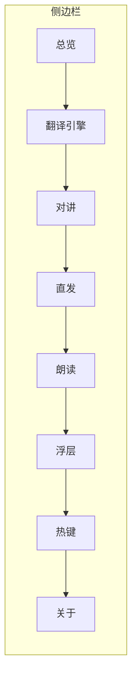

# 面板 v2 设计（待签字）

状态：草稿，等签字后开工。原型在 `redesign/panel-v2` 分支的 `src/renderer/src/prototype/`（一次性代码，正式实现时删除）。

## 一句话

把「6 个 tab 里塞了 11 个关注点」拆成 8 个一级分区 + 全局搜索，样式收敛到一套 token，保存策略统一。

## 现状解剖

| 症状 | 证据 | 后果 |
| --- | --- | --- |
| 整个面板一个文件 | `src/renderer/src/App.tsx` 2234 行、74 个 `useState` | 改任何一行都要读懂半个应用 |
| 一个卡片装了五件事 | `OverlayCard` 占 `App.tsx:437-1133`（700 行），内含 `GroupLabel` 朗读(`:599`)、引擎与嗓子(`:702`)、GPT-SoVITS(`:839`)、对局(`:1087`) | 「浮层与对局」这个 tab 名已经不能描述里面的内容，找东西全靠滚 |
| 两个「嗓子」命名撞车 | 朗读用 `ttsEngine`/`ttsVoice`（`:702`、`:749`）；声出用 `ttsOutEngine`/`ttsOutVoice`（`:1871`、`:1895`） | 用户在两个 tab 里各看到一个「引擎 + 音色」，以为是同一件事，调了这边不生效 |
| 保存策略混用 | 直发/浮层改一下就存（`:391`）；翻译模型要按「保存」（`:1768`） | 用户不知道哪些改动已经生效，关窗口前会反复确认 |
| 文案里写死导航路径 | `App.tsx:196` 写「浮层与对局 → 热键」里改 | 热键独立成页后这句就是死链 |
| 状态与设置混在一屏 | 总览卡片既显示状态又放操作 | 每次进面板先读一堆信息才能动手 |

## 新信息架构

八个一级分区，顶栏常驻搜索。侧边栏是唯一导航，不再有 tab。

为什么要这么分（每条都对应上表一个症状）：

- 对讲与朗读分开：一个是「我说给别人听」，一个是「我听别人说」，使用时机互斥，混在一起每次都要重新找自己那一半
- 浮层单独一页：纯视觉、调得最频繁，和别的关注点没有数据依赖
- 音色包跟着声出走：它是声出的资产，不是独立功能
- 热键独立一页：它是横跨所有分区的开关表，塞进谁家都不合适

## 每个分区的行清单

处置列含义：**常显** = 一眼看到；**折叠** = 默认收起，点开才见；**移出** = 换到别的分区；**删** = 不再暴露。

### 总览

| 行 | 处置 | 说明 |
| --- | --- | --- |
| 链路四态（模型服务 / 捕获 / 翻译 / 声出） | 常显 | 大条，最大的一屏元素 |
| 一键自检 | 常显 | 主按钮，跑完就地展开明细 |
| 体检清单（每项 通过/失败 + 详情） | 折叠 | 自检后自动展开 |
| 会话层回退、上次翻译耗时 | 常显 | 小字，两列 |
| 热键提示 | 删 | 改为指向侧边栏「热键」，不再写死路径 |

### 翻译引擎

| 分组 | 行 | 处置 |
| --- | --- | --- |
| 服务 | 预设 / 接口地址 / API Key / 模型 / 代理 | 常显 |
| 输出 | 浮层译文语言 / 译文词数上限 | 常显 |
| 推理 | 思考开关（按 provider 能力显示） | 折叠 |
| 缓存 | 清空翻译缓存 | 折叠 |
| 试验台 | 输入框 + 试翻 + 结果 | 常显（页面底部） |

原「翻译试用」tab 并进来当一个试验台，不再占一个一级项。

### 对讲（我说给别人听）

| 分组 | 行 | 处置 |
| --- | --- | --- |
| 声音输出 | 声出引擎 / 声出音色 / 输出设备（VB-Cable） | 常显 |
| | 音色包管理（安装 / 切换 / 下载进度） | 折叠 |
| | GV 服务地址、参考音频、参考语言 | 折叠 |
| 语音输入 | 识别引擎 / 热词 / whisper 路径 | 常显 |
| | Qwen3 模型安装与解压进度 | 折叠 |
| 触发 | 说话键 | 常显 |
| 调试 | 说一句试试 / 识别记录（6 条） | 常显 |

### 直发（打字发进聊天框）

| 行 | 处置 |
| --- | --- |
| 发送通道（原地替换 / 浮层粘贴 / 控制台） | 常显 |
| 控制台开关键（仅控制台模式显示） | 常显 |
| 语气 | 常显，从浮层回复框提到这里 |
| 最近回复（5 条可回填） | 折叠 |

### 朗读（我听别人说）

| 行 | 处置 |
| --- | --- |
| 朗读开关 | 常显 |
| 合成引擎 / 音色 / 语速 / 音调 | 常显 |
| 读自己的话 / 丢掉积压 / 分句字数 | 折叠 |
| 前缀模板（句首 / 句尾 / 不念） | 折叠 |
| 离线模型状态与下载 | 折叠 |

### 浮层

| 分组 | 行 | 处置 |
| --- | --- | --- |
| 显示 | 显示/隐藏 · 锁定 · 收起 · 还原位置大小 | 常显（按钮组） |
| 外观 | 底色深浅 / 显示模式（译文 / 双语 / 原文） | 常显 |
| 位置 | 当前几何读数 | 常显（小字） |
| 对局 | 开机自动捕获 / 自己的昵称 | 常显 |

### 热键

| 行 | 处置 |
| --- | --- |
| 六个动作的键位表（点行录制） | 常显 |
| 冲突标记 / 被占用标记 | 常显 |

### 关于

| 行 | 处置 |
| --- | --- |
| 版本 / 更新检查 | 常显 |
| 里程碑 | 折叠 |
| 文档入口 | 常显 |

## 样式规格

一条原则：**颜色只用来表达状态，不用来装饰**。

| 项 | 值 |
| --- | --- |
| 正文 | 14px / 行高 1.6 / 字色 `zinc-300` |
| 次要说明 | 12px / `zinc-500` |
| 分区标题 | 15px / 500 字重 |
| 数值与键名 | 13px / `tabular-nums` / `font-mono` |
| 行高 | 44px（开关、下拉行），多行说明行不限 |
| 组间距 | 24px；同一组内行间距 0（靠分隔线） |
| 卡片 | 单层边框 `#1b1b1f`、圆角 10px、无阴影（深色底看不见阴影） |
| 侧边栏 | 宽 208px，行高 32px，选中态左侧 2px 琥珀条 |
| 主区 | 最大宽 720px 居中；内容不足一屏也不拉伸 |
| 彩色配额 | 三种：选中/主操作 = 琥珀；警告 = 红；就绪 = 绿。其余全走灰阶 |
| 胶囊 | 只用于「会变化的状态」，静态标签一律纯文本 |
| 分隔线 | `#1f1f23`，只在组与组之间，行与行之间用 hover 底色区分 |

## 交互规格

- 搜索：顶栏常驻，`Ctrl+K` 聚焦。匹配行标题与分区名，命中项就地把所在组展开并高亮，清空后恢复原折叠状态。
- 折叠：每组折叠状态记在 localStorage，不写进 `settings.json`（属于视图状态，不该跨设备同步）。
- 保存：全部即时保存。改动后在该行右侧闪一个「已保存」1.2 秒，失败则原地显示红色原因。删除「保存」按钮。
  唯一例外是「热键」页的「保存热键表」：两个动作撞同一个键必须整表校验，逐行落库会让中间状态注册到一个已被占用的
  键上，所以那里保留一次显式保存（实现时确认过，`src/renderer/src/panel/pages/hotkeys.tsx:163`）。
- 空态：每个折叠组打开后若依赖未就绪（如未装音色包），就地给一句话 + 一个行动按钮，不弹窗。

## 保存与反馈

即时保存的实现要点：所有 `setSettings` 调用走同一个 `useSetting` 钩子，钩子内部做乐观更新 + 失败回滚 + 行内反馈。这样「哪些改动已经生效」不再是个问题。

## 迁移计划

| 阶段 | 内容 | 验收 |
| --- | --- | --- |
| M1 | 抽 token 与基础组件（Row / Group / Card / StatusPill / SearchBar），建侧边栏骨架 | 空壳能跑，tsc 与 eslint 干净 |
| M2 | 迁「翻译引擎」「关于」「热键」三页 | 这三页功能与旧版逐项对齐 |
| M3 | 迁「浮层」「朗读」 | 浮层按钮组与朗读模板全部可用 |
| M4 | 迁「对讲」「直发」「总览」 | 语音链路与声出设备可选可试听 |
| M5 | 删旧 App.tsx、删原型目录 | 仓库里只剩一套实现 |

M1–M5 已落地（提交 `ab2eb85` … `f1e228f` 之后的 `M4`/`M5` 两次提交）。删掉的东西：`App.tsx`、
`prototype/`、`components/hotkey-card.tsx`、`ui/{badge,card,label,tabs,textarea}`（除 `App.tsx` 无别处引用）、
`scripts/dev-query.mjs` 与 `dev:panel`/`dev:proto` 两个脚本（面板只有一套，deep link 改由 `OMD2_QUERY` 承担）。
eslint 的常驻警告从 2 个降到 1 个：`badge.tsx` 删了，只剩 `button.tsx:41`。

## 验收标准

- 每个设置项有且只有一个归属分区，全仓库搜不到重复渲染
- `npx tsc --noEmit` 两套配置 0 错；`npx eslint .` 只剩 1 个 `react-refresh` 警告（`button.tsx:41`）
- 首屏（总览）不滚动即可看到四个链路的当前状态
- 改任意一项后 1 秒内能在浮层或状态条上看到效果，无需手动保存
- 面板文案里不再出现写死的热键名或导航路径

## 签字前请确认三件事

- 直发的「语气」提到一级行（现在藏在浮层回复框里），还是留在回复框
- 「识别记录」放对讲页还是收到调试区
- 里程碑是留在「关于」折叠里，还是干脆删掉（它更像开发日志）
