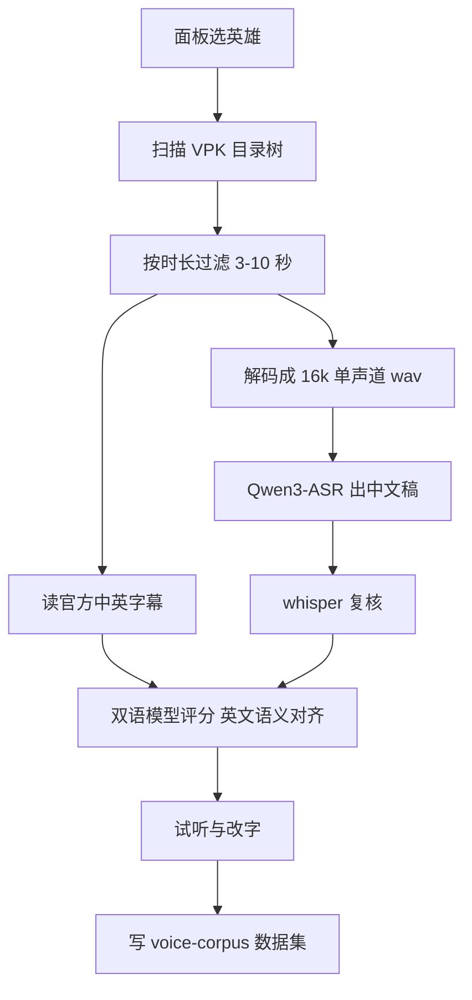

# 语音素材（Dota2 → GV 训练集）设计

状态：草稿。等三项指标实测回来后签字，签字前不开工。

## 一句话

从本机 Dota2 的 VPK 里取出英雄中文配音，配上尽量可靠的文本，产出 GV 能直接训的数据集；入口是面板新增的「语音素材」页。

## 目标与边界

进：选英雄 → 看到中英条数与时长、每条文本的来源 → 提取 + 识别 + 评分 → 试听改字 → 产出数据集。

出：`userData/voice-corpus/<hero>/` 一套带 provenance 的 wav + 文本清单；GV 训练仍走现有音色训练页，本页只负责「语料」。

不做：不自动开训；不内置任何第三方台词站；不把英雄原声当产品音色分发。

## 数据源（本机实测）

| 项 | 数值 |
|---|---|
| 英文包 | `game/dota/pak01_dir.vpk`，205 个 vo 目录 / 95,427 条 |
| 中文包 | `game/dota_schinese/pak01_dir.vpk`，约 4.5GB / 43 个分包 / 164 目录 / 86,137 条 |
| 容器格式 | `.vsnd_c` 前 4 字节是 MP3 起点，其后是 CBR MP3；英文 64kbps，中文 128 或 192kbps，44.1kHz |
| 字幕 | `resource/subtitles/subtitles_<hero>_<lang>.txt`，全部在英文包内；英语 201 份、中文 92 份 |

`dark_willow`（邪影芳灵）实测：中文 1971 条 / 118.1 分钟 / 其中 3–10 秒 1017 条；英文 1972 条 / 91.7 分钟 / 对齐 1970 条。**无中文官方字幕。**

## 答案从哪来（已定：字幕优先 + ASR 评分准入）

| 层 | 来源 | 覆盖 | 成本 | 可信度 |
|---|---|---|---|---|
| 一 | 官方中文字幕 | 92/164 个 vo 目录 | 0 | 高，但**不等于配音台本** |
| 二 | 官方英文字幕 | 201/164，目标英雄基本全有 | 0 | 高，作语义锚 |
| 三 | ASR | 全量 | 约 1.5 秒/条（4 进程） | 3 秒以上可用，短句不可用 |
| 四 | 人工试听改字 | 需要的地方 | 人力 | 最高 |

准入规则：

- 有官方中文字幕的英雄：字幕直接当答案，ASR 只做抽检。
- 无官方中文字幕的英雄：ASR 出稿 → 英文官方字幕当锚 → 模型给 0–100 分，**≥70 收，<70 丢**，中间分进人工队列。
- 字幕本身有 8–10% 与配音不符（实例：`terrorblade_terr_attack_10` 字幕「我要击伤你。」，两引擎一致听成「我要让你生不如死。」），所以第一层是「参考」，第三层才是「音频真相」。冲突时以 ASR 为准并记 provenance。
- 热词不再从「全部英雄名」推导：邪影芳灵 1971 条英文字幕里几乎不出现其他英雄名（首字母大写词频前 20 全是
  You/I'm/Let's 这类句首词，真正的专名只有 `Jex` 20 次、`Mireska` 若干），所以逐条热词是**手写规则 +
  实测误听**驱动的 1–3 个词（`Jex→杰克斯`、`Mireska→米瑞斯卡`、`horn→犄角`），不是自动抽名词。

## 匹配键

音频按 clip basename（`sounds/vo/<hero>/<clip>.vsnd_c`），字幕按 token `<hero>_<clip>`。两者用 basename join；英文实测对齐率接近 100%，中文呈二分流（有字幕的文件整份对齐，没有就是 0）。

## 流水线

每个阶段单独落盘、可续跑：`voice-corpus/<hero>/clips.tsv`、`wav/`、`asr.tsv`、`check.tsv`、`score.jsonl`。停在哪一步重开都只补缺的。

## 面板形态（已定：独立页）

`sections.ts` 新增一项「语音素材」，页面只返回 `Panel` / `Group` / `Row`。

行内必须显示：中文 N 条 · X 分钟（来源徽标）｜英文 M 条 · Y 分钟。低于门槛的英雄标灰并写明原因（无中文字幕 / 台词过少 / 时长集中 1 秒内），不能只显示一个「可用」。

## 已知坑

- GV 备料按 **basename** 在扁平目录里找 wav，中英同名会静默丢失：英文必须 `en_` 前缀，且训练前核对 name2text / semantic / wav32k 三处数量一致。
- 短句不可用：`<1.5 秒` 的 CER 实测 30% 以上，2–3 秒降到 8–10%。
- 热词是 sherpa 的构造期参数，改词表要重载引擎；逐条热搜不是免费操作。
- 热词有硬上限：Qwen3 的 `max_total_len` 512 是**提示词+音频**共用，实测 1–64 个词正常、
  127 个直接返回空文本（不是报错，是空结果，最容易漏判）。别把 127 个英雄名当全局词表。
- whisper 会飘繁体：`-l zh` 也常输出繁体，字符相似度会被压到 80% 上下；用
  `--prompt 以下是普通话的句子。` 只能部分改善，收尾必须过一次 OpenCC（`opencc-js`，`twp→cn`）。
- whisper 在中文游戏黑话上更差（「稳操胜券」听成「婉操盛倩」），跨引擎一致率低不等于 Qwen3 错；
  判定要靠英文语义分 + 抽检，一致率只当异常探测器。
- 全量 ASR 不现实：8.6 万条 × 约 3 秒 ≈ 74 小时；必须按英雄按需跑。

## 实测结果（2026-11-08，邪影芳灵 3–10 秒 1017 条）

三引擎在同一批音频上的表现（1014 条三方都有结果，判重前先去掉标点）：

| 组合 | 平均字符相似度 | p10 |
| --- | --- | --- |
| Qwen3 (sherpa) vs paraformer | 97.6% | 90% |
| Qwen3 vs whisper | 93.8% | 82% |
| paraformer vs whisper | 93.7% | 82% |

- 三方完全一致 538 条（53%）；Qwen3 与 paraformer 一致、whisper 不同的 262 条里，错的多半是 whisper
  （「落荒而逃」→「落荒而躺」、「死期」→「时期」、「回光返照」→「回光反照」），因此 **whisper 只当交叉校验，不进主文本**。
- 段落级别：paraformer 1017 条耗时约 2 分钟/255 条（4 分片并行，含模型加载），远快于 sherpa 逐条的 3.4 秒/条。
- 清洗结果 `dark_willow-cleaned.list`：1014 条 → 保留 1012 条，TEXT_FIX 命中 6 条
  （杰克森→杰克斯、米瑞斯家/敏锐思佳→米瑞斯加），丢弃 1 条乱码、1 条过短；无拉丁字母/数字行，
  字符长度 p10/p50/p90 = 9/13/21。
- 热词逐条注入的收益有限：79 条里只有 12 条发生变化，且真正改对的只有「杰克森→杰克斯」「敏锐思佳→米瑞斯加」，
  「米瑞斯家/米瑞斯加」仍在漂移；**后置 TEXT_FIX 比 ASR 期热词更可靠**。
- 公开渠道已穷尽：官方中文字幕只有 92 个英雄（`dotabuff/d2vpkr`、`spirit-bear-productions/dota_vpk_updates`、
  `muk-as/DOTA2_CLIENT` 三个 VPK 镜像都是 511 个文件、92 个 schinese，与本地一致）；fandom 中文站 21 页有中文
  且是官方字幕搬运；GitHub 代码搜索对实际台词（如「准备好恶作剧了吗」）零命中。

## 识别引擎对比（本机实测，2026-11-08）

| 引擎 | 权重 | 参数 | 本机单条耗时 | 热词 | 可微调 | 角色 |
| --- | --- | --- | --- | --- | --- | --- |
| sherpa Qwen3-ASR 0.6B int8 | 954MB（decoder 721 + encoder 174 + frontend 42） | 0.6B，LLM 底座、自回归 | 约 1.5 秒（CPU，4 进程） | 有，但 `max_total_len` 512 与音频共用 | 有官方 SFT 脚本 | 主文本 |
| FunASR paraformer-large（seaco） | 944MB `model.pt`，目录 953MB | 约 2.2 亿，非自回归 | 约 0.5 秒（CPU，4 进程） | 有（逐条传入即可） | 有（`funasr/bin/train.py` + `init_param`） | 第二票 |
| FunASR contextual_paraformer | 同上量级 | 同上，多一层热词交叉注意力 | 略慢于 paraformer | **原生**（`hotword_pad`/`hotword_lengths`） | 同上 | 备选，专治专名漂移 |
| whisper.cpp small | 488MB `ggml-small.bin` | 2.4 亿 | 与 Qwen3 接近 | 无，只有 `--prompt` | 无 | 只做交叉校验 |

结论与其他两家的关键差异：

- paraformer 家族比 Qwen3-ASR **更快**：同样纯 CPU 单条约 0.5 秒 vs 1.5 秒（2–3 倍），参数只有三分之一、权重体积接近。内存占用**不作为选型依据**——用户机器 64GB，两个引擎各约 950MB 可以忽略。
- 准确率没有明显差距：1014 条样本上与 Qwen3 平均字符相似度 97.6%，三方完全一致 53%；相反 whisper 是三者里最差的那个。
- 微调是「能」不等于「该」：Qwen3-ASR 的微调确实是官方的 —— `QwenLM/Qwen3-ASR`（Apache-2.0）里就有 `finetuning/qwen3_asr_sft.py`（327 行，参数 `--batch_size/--grad_acc/--lr/--epochs/--resume_from`），权重 `Qwen/Qwen3-ASR-0.6B` 在 HF 公开，社区已有日语、韩语微调产物；但它是**全量 SFT 不是 LoRA**，官方建议配 flash-attn，8GB 显存要靠 batch 1 + 梯度累积。paraformer 则要 kaldi 四件套（`wav.scp`/`text`/`utt2spk`/`spk2utt`）加 yaml，pip 包同样不带 recipe。真要提专名准确率，**先换 `contextual_paraformer` 加原生热词**，成本远低于任何一种微调。
- 运行环境：paraformer 只在整合包 runtime 里（`D:/AI/GPT-SoVITS-v2pro-20250604/runtime/python.exe`，funasr 1.0.27 / Python 3.9.13）；本版本 `generate(input="x.wav")` 会报 `AttributeError: 'str' object has no attribute 'shape'`，必须 `soundfile` 读数组再传，输出还需 `''.join(text.split())` 去空格。
- GPU 可用也可关：`AutoModel(model=..., device="cuda:0")` 在本机 4060 Laptop（torch 2.0.0+cu118）实测加载 1.1 秒、单条 0.399 秒、显存峰值约 1GB；同批 20 条 CPU 单进程为 0.712 秒/条。四进程 CPU 并行折算约 0.4 秒/条，与单卡 GPU 基本打平，所以 **ASR 跑 CPU，把 8GB 显存留给 GV 训练**。

## 选型结论（2026-11-08，用户决定后续切 FunASR paraformer）

关注点按用户口径排序（内存不作依据，64GB 机器）：

| 维度 | Qwen3-ASR | FunASR paraformer | 结论 |
| --- | --- | --- | --- |
| 仓库热度 | 3,853★ / 370 fork / 27 issue | 20,963★ / 2,112 fork / 47 issue | paraformer 领先 |
| 最后推送 | 2026-06-26（四个月无更新） | 2026-11-08（当天仍有提交） | paraformer 在维护 |
| issue 维护者回复 | 抽样 7 个 issue **0 条维护者回复**（#163 自 04-27 挂到现在，只有用户和 github-actions 机器人） | 抽样 8 个 issue 有 7 个拿到维护者回复（`LauraGPT` COLLABORATOR、`carey-bk` CONTRIBUTOR）；#3715 六天内回、#3780 当天回并于 11-07 关闭 | paraformer 有人管 |
| 微调速度 | 全量 SFT（官方脚本无 LoRA），官方建议 flash-attn，8GB 只能 batch 1 + 梯度累积 | 非自回归单次前向，220M 参数，`init_param` 可从 paraformer-large 热启动 | paraformer 更快 |
| 环境复杂度 | 简单（pip 装好即用） | 重（kaldi 四件套 + yaml + hydra 训练入口） | 视为专业度，不是缺点 |

行动顺序：**先换 `contextual_paraformer` 上原生热词（零训练）**；专名仍有系统性错法再考虑 paraformer 微调。Qwen3-ASR 在切换前保持现状，whisper 只做交叉校验。决定与理由记在 `docs/adr/asr-hotwords-not-finetune.md` 的 2026-11-08 更正段。

## 训练与验收结果（2026-11-08，邪影芳灵）

- 数据集：1001 条（3–10 秒中文配音），预处理三步 `name2text / semantic / wav32k` 各 1001，无缺失。
- 训练配置：s2 SoVITS bs5 e8（grad_ckpt，201 步/轮，1.5 it/s，8 轮约 18 分钟）；s1 GPT bs6 e15；整机耗时约 34 分钟（20:01–20:15 之间逐档落盘，4060 Laptop，游戏已关）。
- 产物：`SoVITS_weights_v2/dark_willow_e4_s804.pth`、`dark_willow_e8_s1608.pth`、`GPT_weights_v2/dark_willow-e5/e10/e15.ckpt`；最终采用 **e15 + e8/s1608**。
- 参考音频：`dark_willow/sylph_move_13.mp3`（中文包原生 44.1kHz 立体声，80023 字节，实测 3.31 秒），转写「我会证明我才是最厉害的」。
- 验收方式：api_v2 `POST /tts` 合成 → 再用 Qwen3-ASR 回识别做注入式回环，四条测试句（含短句、情绪句、长句）**逐字还原、CER 0**；单句合成 1.8–2.4 秒。
- 结论：文本侧的三引擎 + 字幕纠错链路足以喂饱 GV，不需要官方台词；音色包可按 `dota-voice-release` 直接发。

## 必须有的数字（签字前）

- 三项指标：字幕英雄的 CER 基线、邪影芳灵双引擎一致率、ASR 中文回流对照英文字幕的语义分。
- 体量：1017 条 16k wav 约 140MB；单个满配英雄约 300MB。
- 单英雄耗时：提取+解码+识别+复核，本机实测总时长。
