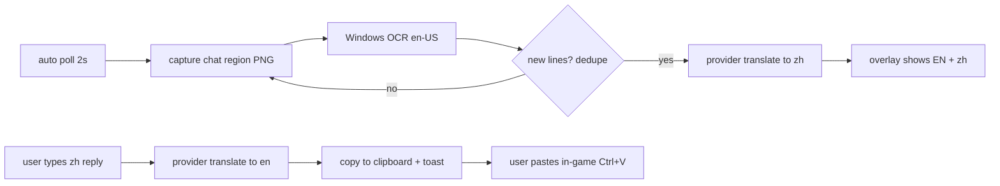

# oh-my-dota2-v3 — Design

Electron + React companion tool for Dota 2 players to communicate with foreign teammates. Zero game injection (VAC-safe), all capture happens outside the game process.

## Goals

- Chat translation: OCR teammates' in-game chat → translate → transparent overlay; reply in Chinese → translated to English → clipboard.
- Voice translation (skeleton): teammate voice (loopback capture) → local whisper.cpp → translated transcript.
- Mic language conversion (skeleton): mic (Chinese) → whisper.cpp → translate → TTS (edge-tts) → virtual audio cable as in-game mic.

## Non-goals (v3 MVP)

- No game process injection, no memory reads, no fake input into the game (reply goes through clipboard only).
- No Panorama / in-game native UI (Route C rejected: URL whitelist, key exposure).

## Architecture

```
oh-my-dota2-v3/
├── src/
│   ├── main/                  # Electron main process
│   │   ├── index.ts           # app lifecycle, proxy, dashboard window
│   │   ├── ipc.ts             # typed IPC handlers
│   │   ├── services/
│   │   │   ├── settings.ts        # JSON settings (userData/settings.json)
│   │   │   ├── providers/         # LLM abstraction (OpenAI-compatible chat)
│   │   │   │   ├── index.ts       # presets, translateText, testProvider
│   │   │   │   └── openai-compat.ts  # baseUrl+apiKey+model via electron net.fetch
│   │   │   ├── ocr/               # M2: OcrEngine interface + windows-ocr.ts bridge
│   │   │   ├── capture.ts         # M2: screen region capture (DPI-aware)
│   │   │   ├── chatwatch.ts       # M2: poll loop: capture → OCR → dedupe → translate
│   │   │   ├── hotkeys.ts         # M2: global shortcuts
│   │   │   └── voice/             # M4 SKELETON: whisper.cpp, audio-capture, edge-tts
│   │   └── windows/               # M2: overlay.ts, region-select.ts
│   ├── preload/               # typed contextBridge (window.api = WindowApi)
│   ├── shared/                # IPC contract: types, presets, channel names
│   └── renderer/              # React + Tailwind + shadcn-style UI
│       └── src/
│           ├── App.tsx        # dashboard: provider, try-translation, voice, about tabs
│           ├── components/ui/ # hand-rolled shadcn-style primitives
│           └── overlay/       # M2: bilingual chat feed + reply input
├── docs/DESIGN.md
└── package.json
```

## Chat translation flow (Route B: OCR + AI + overlay, zero injection)



- OCR engine: Windows.Media.Ocr (built-in, offline, good for Latin text); engine interface allows tesseract.js / cloud vision later.
- Dedupe: hash of normalized line set; only translate deltas.
- Translation prompt: game-chat register, keep jargon (hero names, gg, ss, b) stable, short output.

## Provider layer

Single interface, OpenAI-compatible `/chat/completions`:

| preset | baseUrl | default model |
| --- | --- | --- |
| DeepSeek (default) | https://api.deepseek.com | deepseek-chat |
| OpenAI | https://api.openai.com/v1 | gpt-4o-mini |
| Ollama (local) | http://localhost:11434/v1 | qwen2.5:7b |
| Custom | user-set | user-set |

All requests go through the system proxy when set (Electron `session.setProxy`).

## Voice modules — skeleton only in MVP

- whisper.cpp: spawn CLI (`whisper-cli.exe`) with wav input; interface ready, binary path configured in settings.
- Loopback (teammate voice): Electron `desktopCapturer` audio loopback → wav chunks (stub).
- Mic conversion: mic capture → whisper → translate → edge-tts (free neural voices) → output device = VB-Cable (stub; settings pick output device).

## IPC contract

Typed channels in `src/shared/ipc.ts`, e.g. `settings:get/set`, `chat:start/stop`, `chat:lines` (event), `overlay:reply`, `region:begin` (event back with rect). No `ipcRenderer.on` outside preload.

## Milestones

- M1 scaffold: electron-vite + React + TS + Tailwind + shadcn/ui, settings store, provider layer + test panel, git init. ← this session
- M2 chat capture: region selector, capture, Windows OCR bridge, dedupe, overlay window.
- M3 reply flow: translate + clipboard + overlay input.
- M4 voice skeletons wired: whisper.cpp path check, edge-tts preview button.

## Conventions

- TS strict, ESLint flat config + Prettier.
- Personal OSS repo: commits in English (Conventional Commits), author mystery4f.
