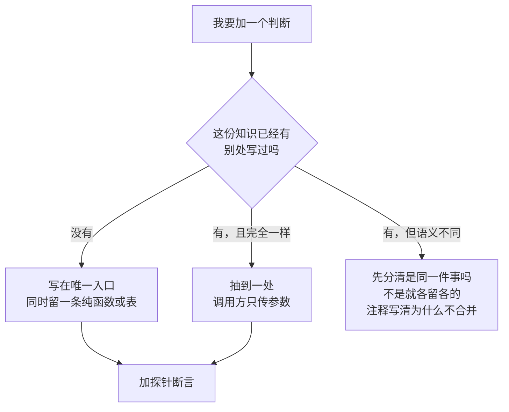

# 代码规范

这份文档只为一件事存在：**同一份知识不要写第二遍**。

AI 和人犯的是同一种错——在新调用点把上一处的判断抄一遍。抄完当天能跑，第二周两个实现开始分叉，
用户看到的是「同一个设置，两个地方表现不一样」。下面每一条都来自这个仓库里真实发生过的案例。

## 一条判断：这份知识写在几处？

写新代码前先问一句。答案落在哪一档，决定了怎么下手：

「语义不同就各留各的」不是偷懒的借口。判定标准很硬：**两个实现会不会因为同一条规则改变而同时改**。
会 → 是同一件事；不会 → 分开，并在注释里写明分界。

## 收口的最低标准

- 知识（规则、阈值、枚举、映射）只有一份；**执行方式**可以在多处，因为它们本来就地不同。
- 收口是「把判断搬走」，不是「把调用包一层」。包一层而判断还在调用方，只是多了一个中间人。
- 一次只收一件事：`speech-plan.ts` 只算计划值，`download.ts` 只管镜像与续传。
- 收口后**行为必须不变**，除非这次的目标就是修 bug；两者混在一个改动里，探针红了分不清是谁的错。

## 三个样板（照它们写）

### 一、计划值 + 引擎表：`src/shared/speech-plan.ts`

同一件事——「这个引擎该怎么合成」——曾经由四条腿各判一次（朗读、声出、试听、声出测试）。
症状是「面板选了离线音色、点试听念的还是 Edge 那个声」。现在：

- `resolveSpeechPlan()` 一处算出 `{engine, voice, lang, mime, rate, pitch, segmentChars}`；
- `ENGINE_DRIVERS`（`speech-pipeline.ts`）一行一个引擎，声明 `split` / `mime` / `scheduling` / 合成入口；
- 三个 `if (request.engine === …)` 全部变成查表。

**新引擎 = 表里加一行 + 计划值里加一个分支**，不是每个调用点加一个 `if`。

### 二、一次 PowerShell：`src/main/services/input/ps-runner.ts`

三个一次性发送器（聊天框、控制台、说话键）的骨架曾经各写一遍：部署脚本 → 落参数文件 → `spawn` →
超时 → 认 `OK` 握手 → 把退出码翻成人话。差别只有超时数字和提示文案。
现在 `runPs({folder, scriptName, source, args, timeoutMs, timeoutMessage, reasons, noHandshake})`，
`PsSerial` 提供串行链。**新脚本 = 一份 `.ps1` + 一组参数**，不是再抄一遍骨架。

同一条硬规矩仍然成立：部署进 `userData` 的 `.ps1` 必须纯 ASCII（PowerShell 5.1 按 ANSI 解码）。

### 三、可续传下载：`src/main/services/net/download.ts`

四个下载口各写一套重试：镜像前缀只有一处有、停滞看门狗只有一处有、`.part` 续传只有一处有、
完整性口径三处不同。「下载失败」在这个项目里是常态，于是用户每次遇到的是不同的失败。
现在只留两种形状：`tryMirrors()`（直连 → 加速前缀）与 `downloadResumable()`（`.part` + Range + 原子改名）。
whisper 的并行分块是第三种形状，刻意留在原处并在注释里说明——**别为了「统一」换掉它的并发优势**。

## 表驱动 vs 分支

- 枚举 × 固定字段（引擎 → 格式/切不切段）→ **写表**。表让「漏了一个引擎」变成编译错误。
- 枚举 × 不同的调用形状（每个引擎的合成函数签名不同）→ **适配器收进表里**，别把签名拉平成一堆可选参数。
- 真正的顺序逻辑（排期、生成号、丢弃）留在过程里，表只放声明。

## 纯函数缝与探针

- 需要被验证的判断必须是**纯函数**，且放在 `src/shared/` 或能被探针直接导入的位置。
- 每个新规则配一条探针断言。探针名字说人话：「同一句中文四条腿都判 zh」，不是「test lang」。
- 探针里出现**断言要改**，先停下来问：是行为契约该变，还是你把契约弄坏了？
- 模块级的可变状态（缓存、计数、生成号）要能被重置，否则探针只能跑一次。

## 注释写为什么

- 写「为什么会这样」，不写「这行在做什么」。
- 每个不显然的常量后面跟一句实测依据：「实测：`reasoning_effort:'none'` 把同一句从 7.4s 压到 1.4s」。
- 改版迁移写在钳制处，写清旧值长什么样、为什么不抛错（设置文件是用户数据）。
- 注释里出现过一次的坑，不要再在第二处重写一遍——把它指向唯一那份。

## 面板与主进程的边界

- 字段的**归属**由面板页声明；写入只提交本页拥有的字段，整对象回写会把别的页刚写的值按旧快照盖回去。
- 归一化只在主进程做一次（`normalizeSettings`），读盘与写盘都过它；写盘不过它，磁盘上就会留下「重启后才变」的值。
- 渲染层不实现主进程已经有的策略；只做「这台机器只有渲染层能做」的那部分（例如系统嗓子的 `speechSynthesis`）。

## 语言

- 界面文案、代码注释、文档：中文；标识符、API、配置键：原文。
- 用户可见的错误必须是**人话**：说清哪件事失败、下一步点哪里。分引擎/分通道的失败原因写在一张表里。

## 提交前自检

- 新加的 `if` 里，有没有一条判断在别处也能搜到同样的字符串？搜一下。
- 新常量是不是和某个已有常量同义？同一个数字出现第三次就该有名字。
- 新分支是不是让某个 `switch` 变成了两处必须同时改？是的话改成表。
- 两个 tsconfig 都过了吗？`npx eslint .` 只有两条永久 warning 吗？受影响的探针跑了吗？
- 改动里的「修 bug」和「搬代码」是不是混在一起了？混了就拆开。

## 评审只问三个问题

- 这份知识现在写在几处？如果两处，为什么不是一处？
- 删掉这个新模块，复杂度会消失还是散回 N 个调用方？散回去说明它该留，但它得真的集中了什么。
- 新规则有探针吗？探针失败时，人能读懂是哪条契约坏了吗？
